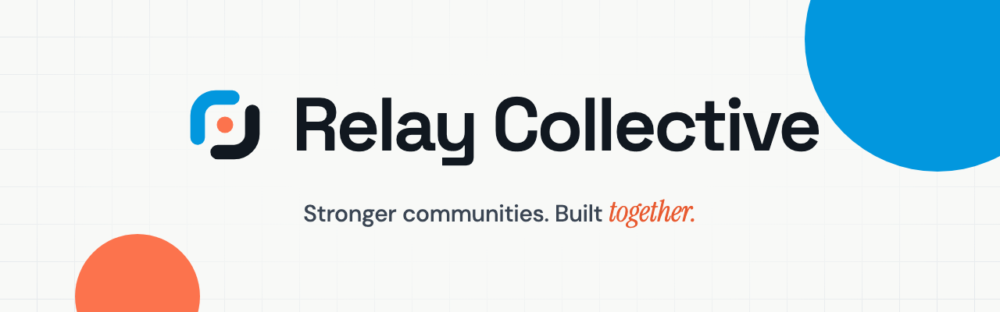
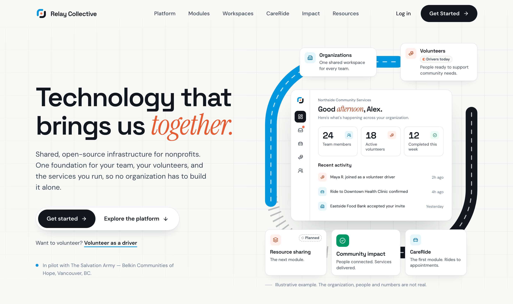
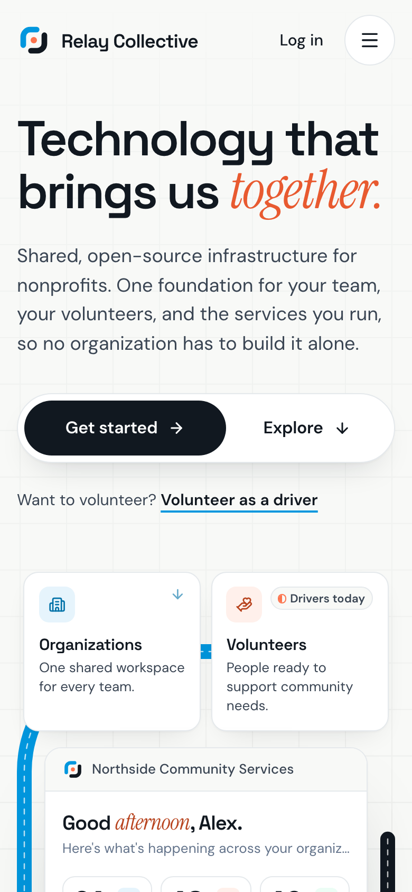
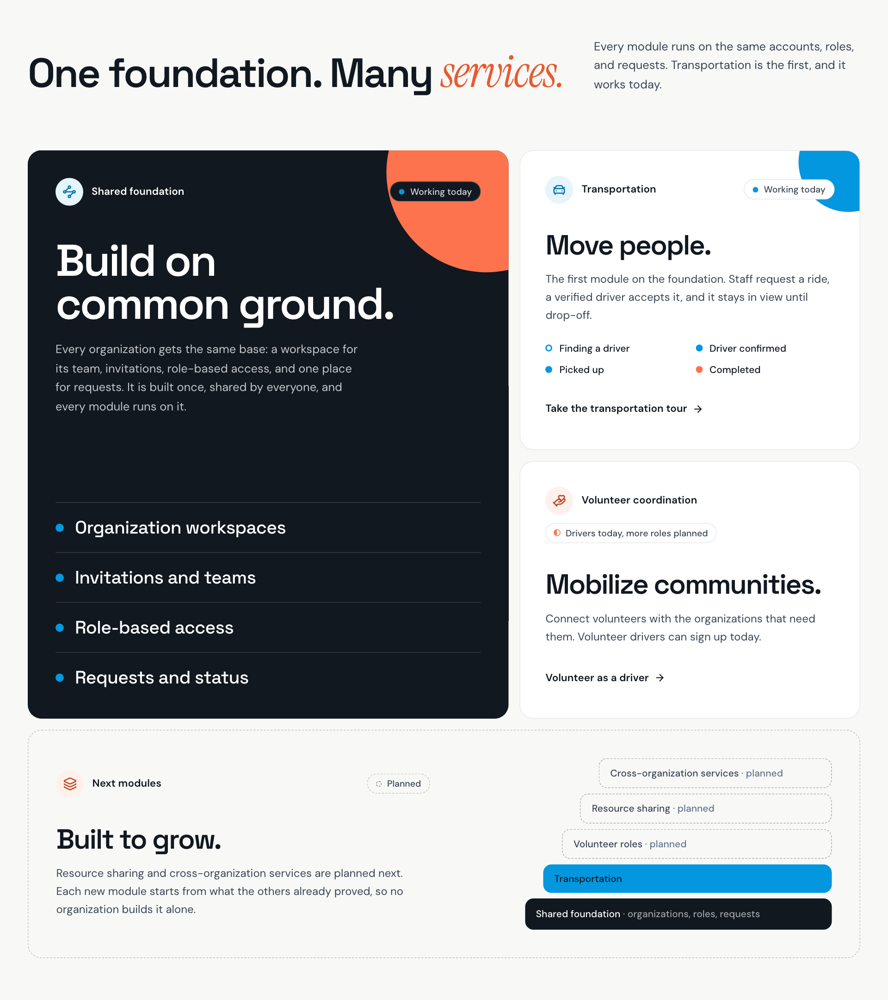
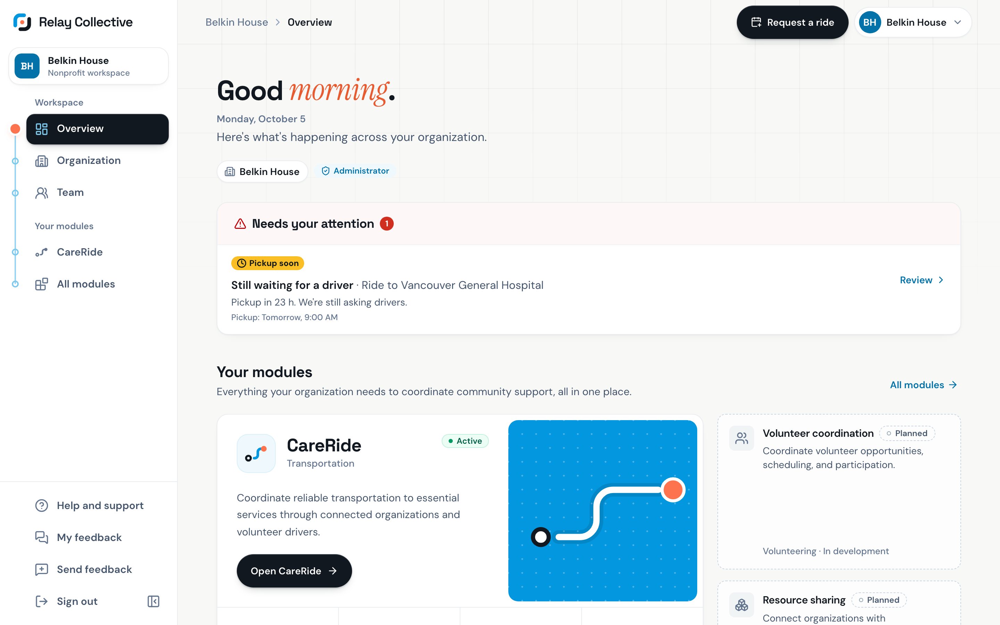
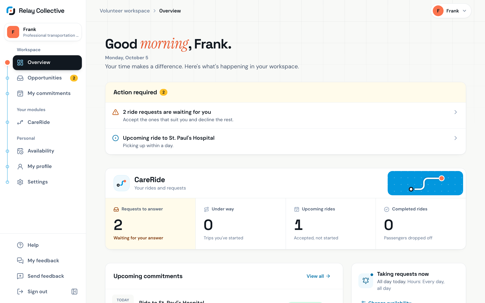
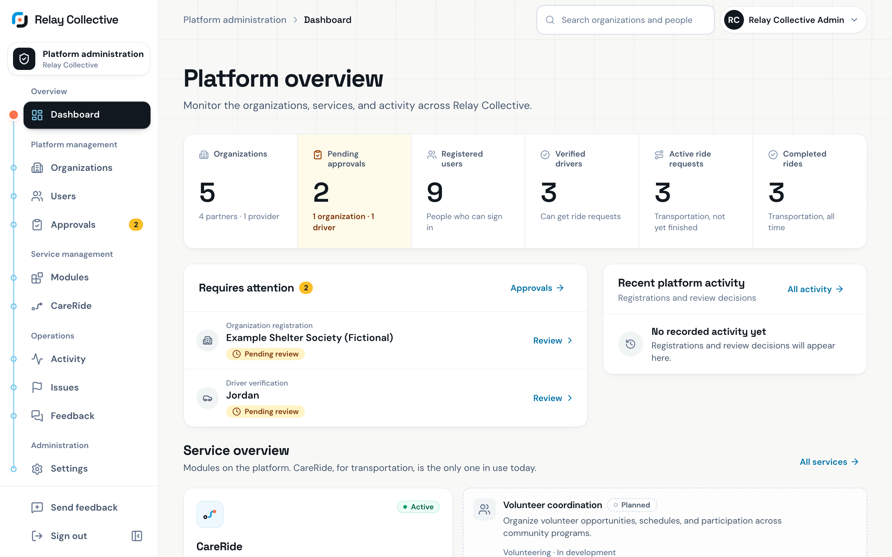
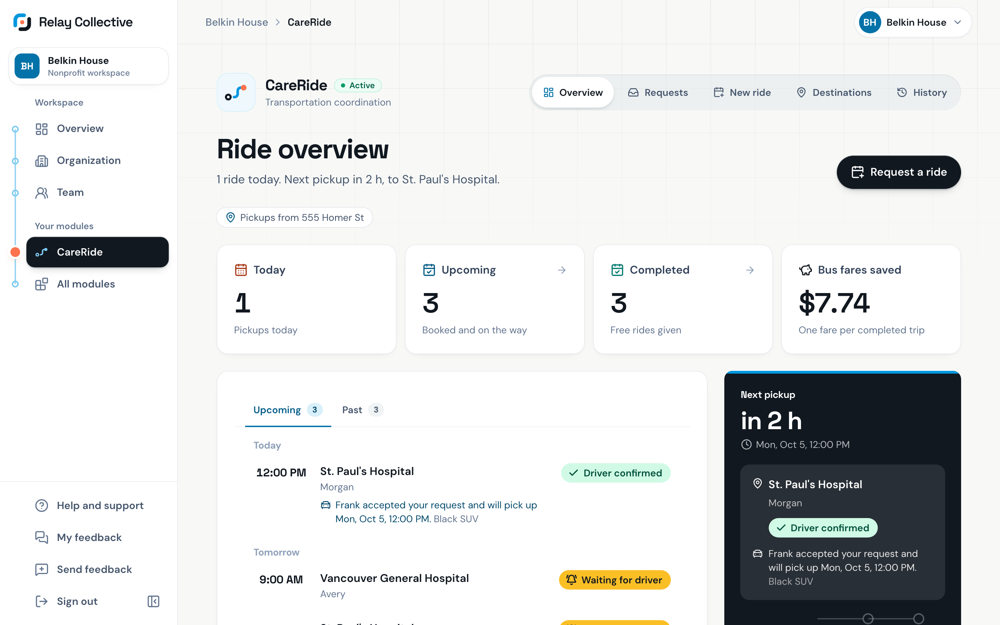
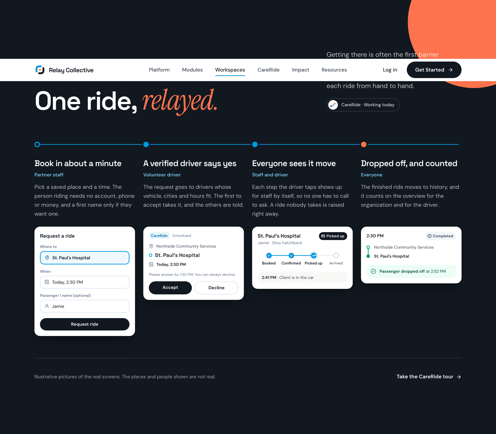

  

<h3 align="center">Shared digital infrastructure for nonprofits.</h3>

  Relay Collective is shared, open-source infrastructure that connects nonprofit organizations, volunteers, and community resources: one foundation for your team, your volunteers, and the services you run, so no organization has to build it alone.

  
  
  

  
  
  
  
  
  

 

  
  &nbsp;
  

## What we're building

Every nonprofit rebuilds the same tools. We'd rather build them once. Relay Collective is one open foundation, with modules on top: every module runs on the same accounts, roles, and requests. CareRide, for transportation, is the first, and it works today.

| Part | What it does | Status |
| --- | --- | --- |
| **Shared foundation** | Organization workspaces, invitations and teams, join requests, role-based access, and requests with status. Built once, shared by everyone. | Working today |
| **CareRide (transportation)** | The first module. Staff request a ride for someone they support, a verified driver accepts it, and it stays in view until drop-off. | Working today |
| **Volunteer coordination** | Connects volunteers with the organizations that need them. | Drivers today, more roles planned |
| **Next modules** | Resource sharing and cross-organization services, each starting from what the others already proved. | Planned |

  

## Inside the workspaces

One platform, with a workspace for each role that uses it. All three share the same sidebar, a route of stations with the current page marked, and every overview opens with what needs you first.

### Organizations

Partner staff book support for the people they serve. The overview raises anything no one has picked up yet, then shows each module with its own numbers: CareRide's rides that need attention, are waiting for a driver, are under way, and are done. Staff join from one invitation, with only the access their role needs.

  

### Volunteer drivers

Verified drivers get ride requests that fit their vehicle, the cities they drive in, and their hours. They accept what suits them and decline the rest, then work through each trip step by step.

  

### Platform admins

The people who run the platform see the whole network on one page, and review every organization and every driver before their first ride.

  

## CareRide: one ride, relayed

CareRide is the transportation module, and the first one built on the foundation. A ride passes from hand to hand: staff book it in about a minute, a verified driver accepts it, both sides watch each step, and it lands in history. The person riding needs no account, phone, or money.

  

  

The screenshots above come from the app's demo mode, with made-up organizations, people, and rides. To take them again after a change, run `npm run docs:screenshots`.

## Our story

Relay Collective started as a hackathon project at **FaithTech HACKVAN 2026**, developed in partnership with **The Salvation Army – Belkin Communities of Hope**, our pilot partner in Vancouver, BC.

Working alongside people on the front lines showed us where the barriers really are. Our first focus became clear: making **transportation** more accessible, reliable, and inclusive, because getting there is so often the first barrier between a person and the help that already exists.

That project has since grown into a long-term initiative. Transportation is where we started, but it isn't where we stop: it's the first module on a shared, open-source foundation where nonprofits can share resources, coordinate volunteers, and work together to serve their communities. What one organization helps build, every other one can use.

Relay Collective is an independent platform. The Salvation Army is our partner, not our owner.

---

   
  <b>Stronger communities. Built together.</b> 
  <a href="LICENSE">MIT License</a>

